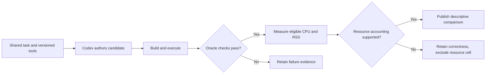
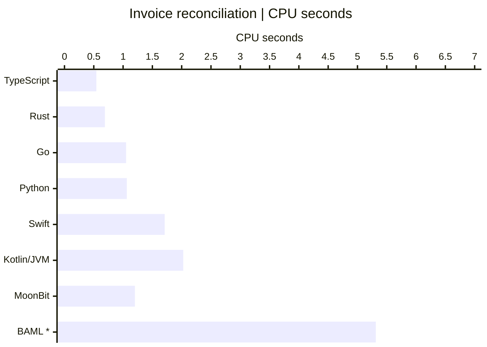
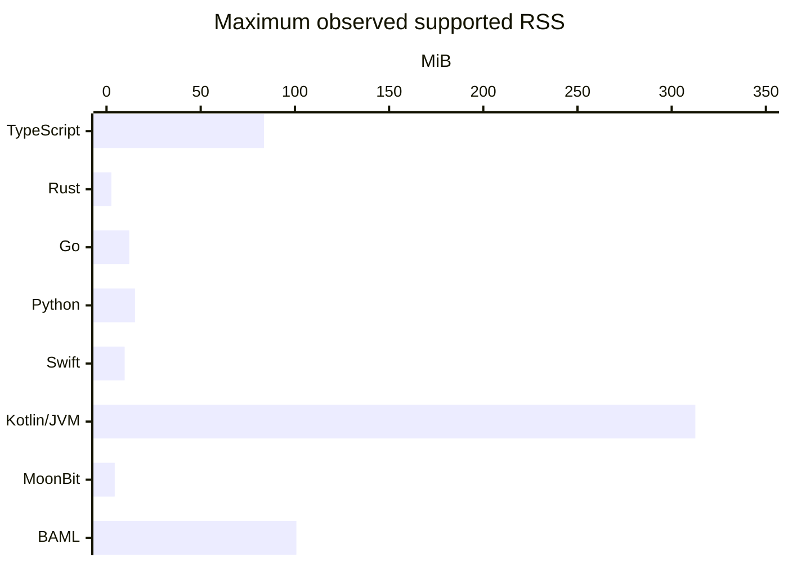

<h1 align="center">Agentic Coding<br>Language Benchmark</h1>

<p align="center">Which language should an AI agent use to write software?</p>

<p align="center"><strong>9 languages · 63 main authoring turns · 42 frozen fixtures · 1 measured host</strong></p>

[](https://github.com/Kian-hdr/agentic-coding-language-benchmark/actions/workflows/verify.yml)

**[Tier list](docs/TIER_LIST.md) · [Visual results](docs/VISUAL_GUIDE.md) · [Set up your agent](docs/AGENTS_SETUP.md) · [Methods](docs/METHODS.md) · [Reproduce](docs/REPRODUCTION.md) · [Raw evidence](archive/)**

**Independent research by Kian-hdr.** A descriptive, AI-assisted comparison of software authored through Codex using the recorded model alias `gpt-6.1-sol` with medium reasoning. Experiments ran October 26–27, 2026 on one Apple Silicon Mac.

The question was practical: **do agent-oriented languages improve software authoring, correctness, resource use or maintenance compared with established languages?** We evaluated TypeScript, Python, Go, Rust, Swift, Kotlin, MoonBit, BAML and Zerolang.

This is an exploratory benchmark with inspectable artifacts, **not a peer-reviewed study, independently replicated experiment or universal language leaderboard**. AI-assisted reviews are additional checks within the same project, not independent human replication. The recorded alias is historical access evidence; this repository does not guarantee public availability of that alias, the same model backend or the original system context.

## Choose a language for the job

These are **use-case recommendations**, separate from the measured results below. An S tier means a preferred starting point for its role, not a universal winner. Keep an existing suitable stack; add another language only for a platform requirement or demonstrated benefit.

| Tier | Language | Where we would start |
|---|---|---|
| **S** | **TypeScript** | Browser UI, typical full-stack web apps and ordinary web backends |
| **S** | **Go** | Standalone services, infrastructure, network tools and CLIs |
| **S** | **Rust** | Memory-sensitive native components and systems code |
| **S in its domain** | **Swift** | Native Apple applications |
| **S in its domain** | **Kotlin** | Native Android applications |
| **S for data / A as a general resource-sensitive default** | **Python** | Automation, scientific/data work and ML libraries |
| **B: bounded pilot** | **MoonBit** | Isolated native/Wasm/JS modules |
| **B: bounded pilot** | **BAML** | Agent-oriented modules integrated into an existing host |
| **D for primary production adoption** | **Zerolang** | Research sandbox |

[Read the full tier list, tradeoffs and selection map →](docs/TIER_LIST.md)

> **The practical default:** TypeScript for a typical public web product; Go for a standalone service or CLI; Rust when memory/control constraints earn the complexity. Swift/Kotlin for native platforms, Python for its automation/data ecosystem. Compatibility means the relevant modern devices, with lower weight than reliability, compute use and continued support.

## Use the policy in your own agent

Want your agent to choose languages this way? Use the **[copy-ready setup prompt](docs/AGENTS_SETUP.md)**, or copy the [policy-only section](policy/PROGRAMMING_LANGUAGE_SELECTION.md). The repository's [AGENTS.md](AGENTS.md) includes the same reusable policy and separately labeled benchmark-maintenance rules. Adoption preserves your existing instructions and authorizes no application migration or compiler installation.

## From an authored program to a supported result



The pilot and deep phase use different tasks and protocols. The diagrams explain the evaluation logic; they are not a claim that every repeated test is an independent software-authoring sample.

## The results, visually

<!-- BEGIN GENERATED OVERVIEW -->
**CPU and memory favor different implementations.** The invoice chart shows CPU for 2,097,152 events; the memory chart shows the maximum supported RSS across all three workloads. Lower is less resource use. These are different measures with different denominators.



CPU marks are medians; n=2 except BAML invoice (*, n=1). Observed spread is in the visual guide and raw table, not a confidence interval. Zerolang is ineligible and is not plotted as zero.



Memory uses the maximum supported observation, not the mean. The linear axis starts at zero. Full supported RSS ranges and all exclusions are shown below and in the visual guide.
<!-- END GENERATED OVERVIEW -->

The native charts are editable Mermaid text, with no PNGs or external chart embeds. [See every workload, exact observed ranges, memory and authoring effort →](docs/VISUAL_GUIDE.md)

## What we observed

Eight languages completed the deeper functional and maintenance task. Zerolang's final build succeeded, but incomplete functional validation made it ineligible for the final resource comparison. In these generated sustained workers, TypeScript/Node had the lowest supported CPU medians in all three workloads; Rust had the lowest supported resident-memory range. Python was quickest to author in the initial deep turn. The specialized candidates did not establish an overall reason to replace an established production stack.

The table reports the **final longer batches**, not authoring time. CPU includes parsing, computation, file IO, startup/JIT and shutdown. Each cell has two repetitions except the explicitly marked n=1 exclusions. Peak RSS spans supported runs across workloads; it is process resident memory, not private/billable memory.

| Language/runtime | Final functional cases | Invoice CPU s | Log CPU s | Telemetry CPU s | Peak RSS MiB |
|---|---|---|---|---|---|
| Python | 221/221 | 1.064 | 1.366 | 2.383 | 14.4–15.1 |
| TypeScript / Node | 221/221 | 0.544 | 0.507 | 0.327 | 65.2–83.6 |
| Go | 221/221 | 1.051 | 1.045 | 0.622 | 5.5–12.1 |
| Rust | 221/221 | 0.689 | 0.561 | 0.387 | 2.2–2.6 |
| Swift | 221/221 | 1.711 | 1.633 | 0.548 | 9.1–9.6 |
| Kotlin / JVM | 221/221 | 2.027 | 1.727 | 1.022 (n=1) | 184.3–312.6 |
| MoonBit native | 221/221 | 1.202 | 1.781 | 0.648 | 3.6–4.4 |
| BAML | 221/221 | 5.313 (n=1) | 6.363 | 2.088 | 86.3–100.8 |
| Zerolang | Incomplete | Ineligible | Ineligible | Ineligible | Ineligible |

Each file has 4,096 requests. Invoice and logs contain 2,097,152 events each; telemetry contains 16,777,216 samples. Two correct runs, BAML invoice repetition 1 and Kotlin telemetry repetition 0, had unsupported process-tree resource accounting and are excluded from CPU/RSS summaries. Correctness credit is retained. There were 54 scheduled final records: 48 correct runs and six explicit Zerolang eligibility skips.

**Interpretation:** these are observed implementations, algorithms, libraries and runtimes on this host. They do not prove intrinsic language speed, production reliability, HTTP latency, mobile battery use or the efficiency of every possible implementation. A small sample cannot justify a general language migration.

## Read the evidence

- [Methods and protocol history](docs/METHODS.md): experimental units, tasks, budgets, oracle, timing and exclusions.
- [Results](docs/RESULTS.md): pilot, all deep stages, long-run observations, authoring receipts and NumPy follow-up.
- [Limitations](docs/LIMITATIONS.md): sampling, causal interpretation, proprietary model access, privacy and external validity.
- [Data dictionary](docs/DATA_DICTIONARY.md): files, counters, missing data, hashes and statuses.
- [Software reproduction guide](docs/REPRODUCTION.md): publication adapters, dependencies and new-run output locations.
- [Model replay boundaries](docs/MODEL_REPLAY.md): deterministic software reruns versus a new model-authoring experiment.
- [Sources](docs/SOURCES.md): primary language/governance documentation and methodological reference.
- Historical [pilot report](archive/pilot/reports/Evaluation_Report.md), [deep report](archive/deep/reports/Deep_Evaluation_Report.md), [raw long-run records](archive/deep/results/long_run.json) and [review notes](archive/reviews/).

## Design at a glance

| Part | Software-authoring sample | Tasks and changes |
|---|---|---|
| Pilot | Two fresh starts per language; initial plus extension: 36 main model turns | Ledger, topological ordering and expression parsing; then interval merging |
| Deeper comparison | One new application per language; initial, repair/optimization and maintenance: 27 main model turns | Invoice reconciliation, log aggregation and rolling telemetry; then backward-compatible invoice fees |
| Follow-ups | Repeated execution of frozen final programs; one additional NumPy authoring turn | Larger transformed files; separate native-library Python reference |

The main study therefore contains **63 model turns**, plus the separately disclosed NumPy turn. Repeated runtime samples are not fresh model implementations. The locally written protocol was not externally preregistered. Later long-run tests and the NumPy follow-up are exploratory additions, not retrospectively preregistered outcomes.

Correctness is required before resource credit. Reliability, CPU/memory use and continued support informed the original practical decision. Agent effort is separate. Compatibility is a lower-weight check for the required **current devices and operating systems**, with no extra credit for obsolete hardware. No universal weighted score is calculated.

## Reproduction and verification status

There are two distinct activities: verify/analyze published evidence, or build and run archived programs again. Neither needs a model API. Model re-authoring is a separate opt-in experiment, with different costs and reproducibility limits.

The following are **publication-time entry points**, separate from the archived historical harness. Their local verification status is listed below; later CI must not be confused with execution of the original experiment. Check their help and [toolchain guide](docs/TOOLCHAINS.md) before costly builds.

```sh
python3 scripts/verify.py
python3 scripts/verify.py --full
python3 scripts/analyze.py --check
python3 scripts/datasets.py
python3 scripts/datasets.py --long
python3 scripts/reproduce.py build typescript --stage maintenance
python3 scripts/reproduce.py validate typescript --stage maintenance
python3 scripts/reproduce.py perf typescript --stage maintenance
```

Local publication verification completed:

- `verify.py --full` passed for 952 exported files, 42 frozen fixtures and 3,946 oracle comparisons; `analyze.py --check` passed.
- `datasets.py --long` reproduced all original longer input/expected hashes; ten focused unit tests passed.
- The portable Python adapter built and passed all four final deep validation files (221 responses), plus pilot initial trial 1 (69 checks) and extension trial 2 (89 checks).

These are local publication-tool checks, not independent replication of model authoring or the historical resource measurements. Other language adapters have **not been revalidated for this public release**. A heavy compiler batch was deferred because of host memory pressure; adapter availability is not a cross-platform success claim. See [reproduction](docs/REPRODUCTION.md), [toolchains](docs/TOOLCHAINS.md) and [provenance](docs/PROVENANCE.md).

`datasets.py --long` uses substantial disk space. Builds need separately installed toolchains and approved dependencies. Verification, analysis and CI make no automatic model-authoring calls. See [replay boundaries](docs/MODEL_REPLAY.md).

## Repository layout

- `archive/pilot/`: scored source snapshots, specifications, prompts, packets, metrics, results and historical scripts.
- `archive/deep/`: stage snapshots, prompts, metrics, raw measurements, compatibility records, supplementary NumPy source and historical scripts.
- `archive/toolchain_notes/` and `archive/reviews/`: dated setup/research and AI-assisted checks.
- `data/frozen/`: compressed synthetic fixtures, with `data/fixtures.json`, `data/index.json` and long-file metadata.
- `scripts/`: publication-time verification, analysis and portable reproduction tooling as supplied by the release.
- `docs/`: public explanation and interpretation.

Host/account paths are redacted. Raw agent event transcripts, credentials, binary caches and unrelated private context are omitted. Historical hash fields can refer to the pre-redaction local artifact and are not automatically hashes of its public transformed counterpart. Failure observations and missing usage remain explicit. Refer to the release's provenance and license files for redistribution details; this README does not grant rights to third-party toolchains.

## Public verification

The corrected public verification workflow passed on **Linux, macOS and Windows**: [run40409920865](https://github.com/Kian-hdr/agentic-coding-language-benchmark/actions/runs/40409920865). Linux/macOS also rebuild and validate the Python worker; Windows verifies the evidence, analysis, units and public-file checks. This verifies the public package, not nine-language consumer-app compatibility or independent model replication.

## Open source and open research

Our original **code, study write-up, documentation, synthetic fixtures, measured results and native chart definitions are MIT-licensed**. You can run the benchmark on your own hardware, test other models or workloads, fork it, reuse the materials and contribute improvements or new result records through pull requests. Preserve the MIT copyright/permission notice when redistributing covered material.

Read [LICENSE](LICENSE), the [licensing scope](LICENSING.md), and [contribution guidance](CONTRIBUTING.md). External compilers, SDKs, dependencies and model weights retain their own terms. This project grants reuse permissions for its original material, not rights it does not hold in third-party components.
