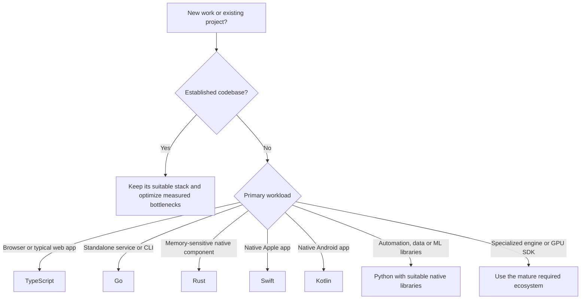

# The tier list: choose by workload

**Decision guide, October 27, 2026.** These are the maintainer's use-case recommendations informed by the benchmark and ecosystem research. They are not numerical benchmark scores, measured vendor-survival probabilities, or a universal ordering of language capability.

[Back to overview](../README.md) · [Measured results](RESULTS.md) · [Visual guide](VISUAL_GUIDE.md) · [Sources](SOURCES.md)

## At a glance

| Tier | Language | Default role | Why it belongs here | Main tradeoff |
|---|---|---|---|---|
| **S** | **TypeScript** | Browser UI, typical full-stack web apps and ordinary web backends | Strong web fit; lowest CPU in these final generated batch workers | More resident memory than the native workers; runtime input validation still matters |
| **S** | **Go** | Standalone services, infrastructure, network tools and CLIs | Simple deployment/maintenance tradeoff; useful resource economy | Not the CPU winner in the longer batches; no automatic native mobile UI |
| **S** | **Rust** | Memory-sensitive native components and systems code | Lowest measured RSS; compile-time memory checks and resource control | More implementation constraints; optimization turn timed out; no intrinsic speed guarantee |
| **S in its domain** | **Swift** | Native Apple applications | Platform/framework fit and established Apple tooling | CLI performance does not measure SwiftUI or battery; other OS UI needs separate choices |
| **S in its domain** | **Kotlin** | Native Android applications | Android platform ecosystem and established tooling | Tested JVM21 process is not an Android app or Kotlin/Native benchmark |
| **S for automation/data; A as a general resource-sensitive default** | **Python** | Automation, scientific/data work and ML libraries | Shortest observed authoring; mature native-library paths | Loop-heavy CPU work may need vectorization or a measured native kernel |
| **B: bounded pilot** | **MoonBit** | Isolated native/Wasm/JS modules | Substantial toolchain and low measured native RSS | Evolving APIs, compiler source/license/exit considerations and application qualification |
| **B: bounded pilot** | **BAML** | Agent-oriented modules integrated into an existing host | Permissive source and host bridges; deep functional task passed | Higher measured CPU here; young general-purpose application tooling |
| **D for primary production adoption** | **Zerolang** | Research sandbox | Interesting canonical-graph workflow | Incomplete final correctness, native backend friction and upstream experimental warning |

**S** means preferred starting point within the stated workload, **A** a strong alternative whose fit depends on constraints, **B** an isolated experiment, and **D** avoid making it a long-lived production foundation on this evidence. No C-tier entry is forced into an otherwise unsupported category.

## Selection map

## Frontend and backend are routing hints

A browser frontend defaults to TypeScript. An ordinary web backend with authentication, CRUD and integrations can also stay in TypeScript, especially when that keeps the product simple. **Go is not mandatory for every backend.** A standalone service or tool can justify Go's deployment/operational fit. A demonstrated native CPU/memory constraint can justify Rust; check algorithms and existing optimized libraries first.

For shared desktop apps, qualify the complete TypeScript UI/desktop-host stack. For a native Apple/Android experience, choose Swift/Kotlin for the platform. Existing C++, C#, Java and other engine/library requirements override generic defaults. These additional ecosystems were not timed in this nine-language experiment.

## How to use this responsibly

1. Start with required platform behavior and the existing codebase.
2. Require correctness and a realistic deployment path on the relevant modern devices.
3. Profile representative work; consider CPU, RSS, startup, latency and maintenance together.
4. Improve algorithms, allocations, batching and library use before a language rewrite.
5. Introduce another language only when the measured or platform benefit pays for integration and ongoing maintenance.

Compatibility is a practical check for current relevant/flagship targets, with lower weight than reliability, compute efficiency and continued support. No bonus is awarded for extremely old hardware support.

The earlier pilot favored Go on a short prepared ledger process; the longer final generated workers favored TypeScript CPU and Rust memory. **The recommendations therefore combine platform/ecosystem fit with bounded measurements, rather than treating one chart as a universal rule.** Sources and lifecycle evidence are in [Sources](SOURCES.md), [Toolchains](TOOLCHAINS.md) and the [support/platform research](../archive/reviews/Maintenance_and_Use_Cases.md).
