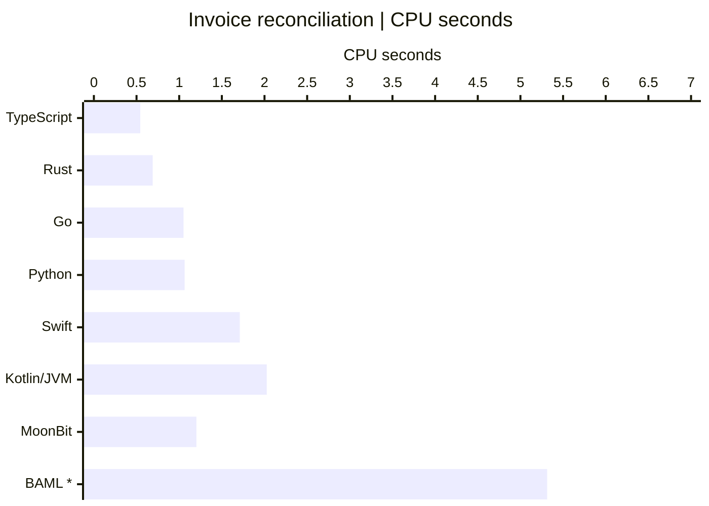
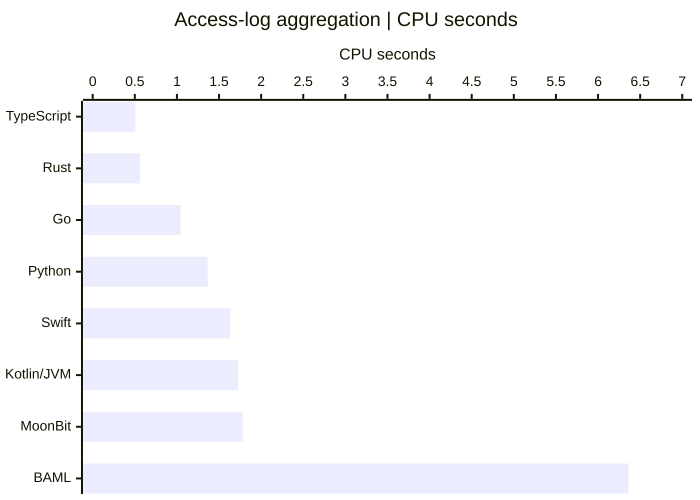
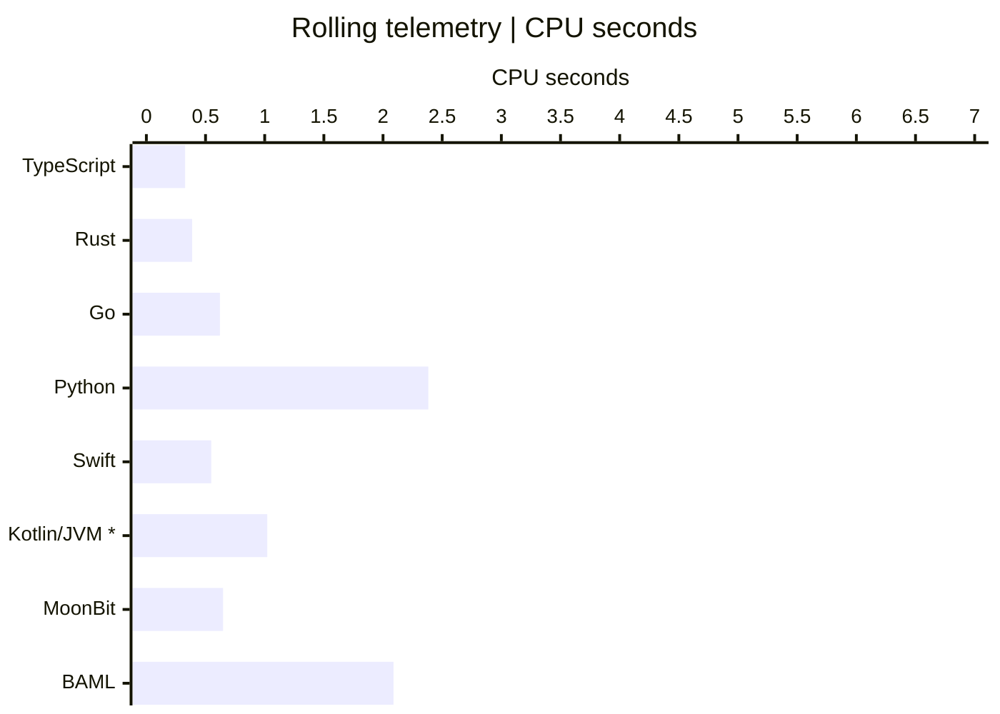
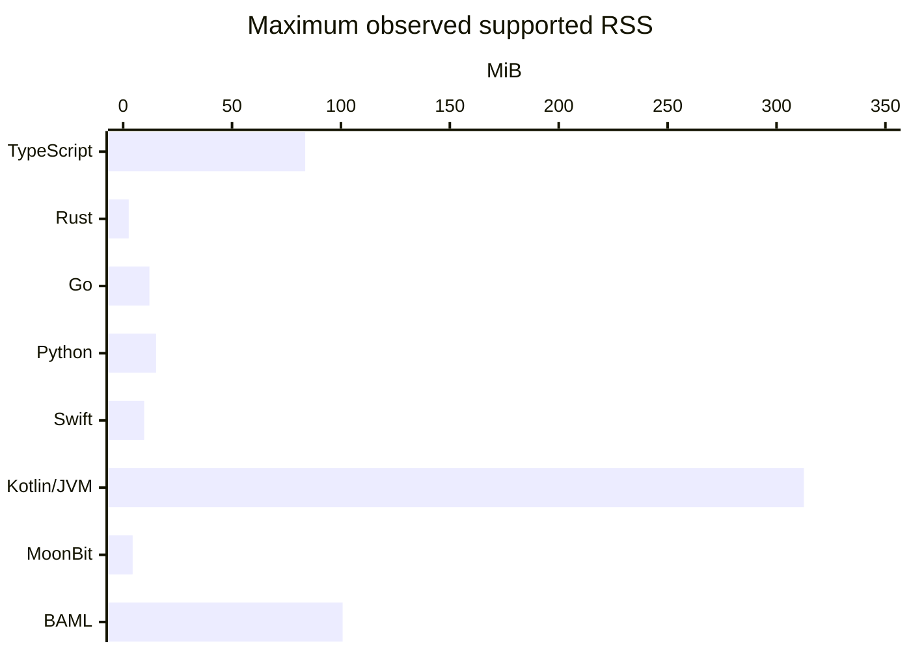
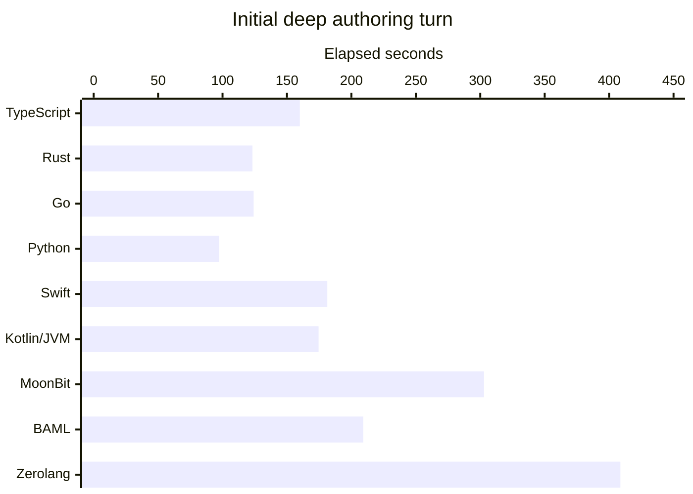
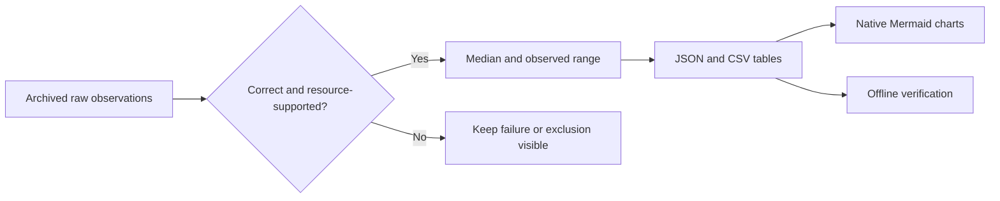

# Visual guide to the measured results

[Overview](../README.md) · [Tier list](TIER_LIST.md) · [Exact tables](../results/TABLES.md) · [Methods](METHODS.md)

These charts are **native Mermaid blocks rendered by GitHub**, editable directly as text. There are no PNGs, rasterized charts, tracking chart services or client scripts to install. GitHub may provide pan/zoom controls; Markdown viewers without Mermaid can still read the source arrays and linked numeric tables.

## CPU time: the complete worker, not a language speed limit

Each chart uses the same category order and **0–7 CPU-second scale**. Lower is less CPU for that file; do not compare throughput across workloads with different item counts. Marks are medians of supported runs, not uncertainty intervals. `*` means one supported resource observation; all other plotted cells have two. Zerolang is omitted because it failed overall final eligibility, not plotted as zero.

The observed min–max ranges immediately below each chart are the sample spread, **not confidence intervals**. Two repetitions cannot establish significance, p95/p99 or a steady-state asymptote.

### Invoice reconciliation

2,097,152 events; 4,096 requests; includes JSON parsing, file IO, startup/JIT and shutdown.



| Language | CPU median s | Observed min–max s | Resource n |
|---|---:|---:|---:|
| TypeScript | 0.544 | 0.536–0.551 | 2 |
| Rust | 0.689 | 0.638–0.741 | 2 |
| Go | 1.051 | 0.997–1.105 | 2 |
| Python | 1.064 | 1.018–1.110 | 2 |
| Swift | 1.711 | 1.516–1.905 | 2 |
| Kotlin/JVM | 2.027 | 1.700–2.354 | 2 |
| MoonBit | 1.202 | 1.171–1.232 | 2 |
| BAML * | 5.313 | 5.313–5.313 | 1 |

### Access-log aggregation

2,097,152 events; 4,096 requests; includes JSON parsing, file IO, startup/JIT and shutdown.



| Language | CPU median s | Observed min–max s | Resource n |
|---|---:|---:|---:|
| TypeScript | 0.507 | 0.501–0.512 | 2 |
| Rust | 0.561 | 0.561–0.562 | 2 |
| Go | 1.045 | 0.992–1.099 | 2 |
| Python | 1.366 | 1.328–1.404 | 2 |
| Swift | 1.633 | 1.577–1.690 | 2 |
| Kotlin/JVM | 1.727 | 1.667–1.786 | 2 |
| MoonBit | 1.781 | 1.218–2.345 | 2 |
| BAML | 6.363 | 5.997–6.730 | 2 |

### Rolling telemetry

16,777,216 samples; 4,096 requests; includes JSON parsing, file IO, startup/JIT and shutdown.



| Language | CPU median s | Observed min–max s | Resource n |
|---|---:|---:|---:|
| TypeScript | 0.327 | 0.326–0.329 | 2 |
| Rust | 0.387 | 0.376–0.398 | 2 |
| Go | 0.622 | 0.563–0.680 | 2 |
| Python | 2.383 | 2.356–2.410 | 2 |
| Swift | 0.548 | 0.508–0.589 | 2 |
| Kotlin/JVM * | 1.022 | 1.022–1.022 | 1 |
| MoonBit | 0.648 | 0.620–0.676 | 2 |
| BAML | 2.088 | 2.054–2.123 | 2 |

## Peak resident memory

Maximum supported process RSS across the three final workload kinds; the table also gives the full observed supported range. This is not an average, private memory, whole-fleet memory or billable reserved memory. The linear axis begins at zero; small native-worker bars are correctly small.



| Language | Observed RSS range MiB | Maximum MiB |
|---|---:|---:|
| TypeScript | 65.2–83.6 | 83.6 |
| Rust | 2.2–2.6 | 2.6 |
| Go | 5.5–12.1 | 12.1 |
| Python | 14.4–15.1 | 15.1 |
| Swift | 9.1–9.6 | 9.6 |
| Kotlin/JVM | 184.3–312.6 | 312.6 |
| MoonBit | 3.6–4.4 | 4.4 |
| BAML | 86.3–100.8 | 100.8 |

## Authoring effort

This is the initial deep authoring turn only: one generated application per language, including service/tool latency. It is not a clean model-thinking or compiler timer. Optimization and maintenance costs must not be silently dropped from a full lifecycle comparison.



Python had the shortest observed initial turn. The four missing optimization receipts prevent a complete billed-cost ranking. Cached input is still a cost category; token units and all receipts are in [Results](RESULTS.md).

## How the measurements reach the charts



## Rebuild these visuals

```sh
python3 scripts/analyze.py --check
python3 scripts/visuals.py
python3 scripts/visuals.py --check
```

`scripts/visuals.py` derives chart values directly from archived records through the same reviewed eligibility filters. `results/visual_data.json` retains the exact plotted data. It never assigns numeric scores to qualitative tiers. Native diagram syntax follows [GitHub documentation](https://docs.github.com/en/get-started/writing-on-github/working-with-advanced-formatting/creating-diagrams); if a renderer changes, use the included tables rather than infer a different result.
